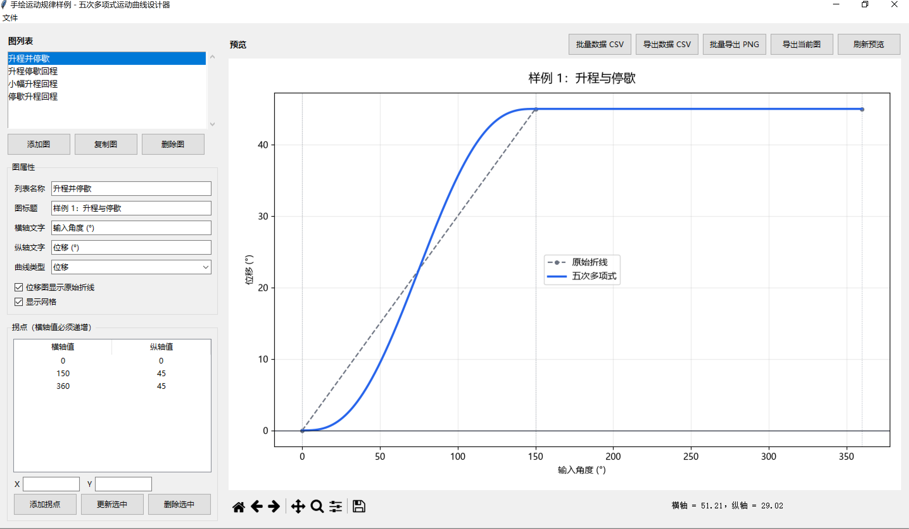

# Quintic Motion Designer

**将离散拐点转换为平滑、可导出、可复用的 C² 连续运动曲线**

面向 Windows 的五次多项式运动曲线设计与数据导出工具。


[核心功能](#-核心功能) ·
[快速开始](#-快速开始) ·
[数据导出](#-数据导出) ·
[数学模型](#-数学模型) ·
[参与贡献](#-参与贡献)

---



*多图管理、拐点编辑与位移 / 速度 / 加速度实时预览*

> **提示：** 不需要手工计算多项式系数。输入横纵坐标拐点，即可预览平滑曲线并导出工程需要的数据和图片。

## ✨ 核心功能

| 能力 | 说明 |
| --- | --- |
| **C² 连续曲线** | 使用归一化五次多项式连接相邻拐点，位置、速度和加速度在拐点处连续 |
| **任意数量拐点** | 添加、更新和删除有序拐点，适配多段升程、停歇与回程规律 |
| **多图项目管理** | 在同一项目中添加、复制和删除多张独立图表 |
| **三类曲线预览** | 随时切换位移、速度和加速度曲线，位移图可叠加原始折线 |
| **中文 Windows 客户端** | 菜单、弹窗、工具栏提示和布局设置均使用中文 |
| **完整图表配置** | 修改图标题、横轴文字、纵轴文字，控制网格与原始折线显示 |
| **图片与数据导出** | 导出 PNG、JPG、SVG、PDF，以及包含三类曲线数据的 CSV |
| **项目持久化** | 保存和打开 `.qmp.json` 项目文件，继续编辑全部图表 |

## 🚀 快速开始

### 下载 Windows 客户端

从仓库的 **Releases** 页面下载最新压缩包：

```text
QuinticMotionDesigner-vX.Y.Z-Windows-x64.zip
```

1. 下载压缩包和同名 `.sha256` 校验文件。
2. 将压缩包完整解压到一个新目录。
3. 运行 `QuinticMotionDesigner.exe`。

> **注意：** 请保留 EXE 和 `_internal` 文件夹的相对位置，不要只复制可执行文件。

### 从源码运行

需要 Windows 和 Python 3.11 或更高版本：

```powershell
git clone <repository-url>
cd quintic-motion-profile
python -m venv .venv
.\.venv\Scripts\Activate.ps1
python -m pip install -e .
quintic-motion-designer
```

也可以在仓库根目录直接执行：

```powershell
python desktop_app.py
```

## 📊 数据导出

每张图使用同一条计算链生成预览和导出结果，避免“界面显示”和“文件数据”不一致。

| 导出方式 | 输出内容 |
| --- | --- |
| **导出当前图数据** | 为当前选中的图生成一个 CSV |
| **批量导出数据** | 按图分别生成 CSV，适合一次导出整个项目 |
| **导出当前图图片** | PNG、JPG、SVG 或 PDF |
| **批量导出图片** | 按图批量生成 PNG |

CSV 文件包含：

| 字段 | 含义 |
| --- | --- |
| `x` | 横轴采样位置 |
| `position` | 五次多项式位移 |
| `velocity` | 位移对横轴的一阶导数 |
| `acceleration` | 位移对横轴的二阶导数 |

所有用户输入的拐点都会被精确纳入导出采样点。

## 📐 数学模型

相邻拐点 `(x₀, y₀)` 与 `(x₁, y₁)` 之间使用归一化最小跃度五次式：

```text
u = (x - x₀) / (x₁ - x₀)
s(u) = 10u³ - 15u⁴ + 6u⁵
y(x) = y₀ + (y₁ - y₀)s(u)
```

因为：

```text
s′(0) = s′(1) = 0
s″(0) = s″(1) = 0
```

所以相邻曲线段在拐点处保持 C² 连续。每个升降段会形成完整的 S 曲线，适合需要平滑启停的机构运动规律设计。

## 🧱 项目结构

| 路径 | 职责 |
| --- | --- |
| `desktop_app.py` | Tkinter Windows 客户端与中文交互 |
| `motion_project.py` | 多图项目模型和 JSON 持久化 |
| `quintic_profile.py` | GUI 无关的五次轨迹数值引擎 |
| `chart_renderer.py` | 预览、图片导出和 CSV 导出 |
| `tests/` | 数值、项目模型和客户端确定性测试 |
| `scripts/` | Windows 构建与 Release 归档 |
| `.github/workflows/` | CI 和标签驱动的自动发布 |

架构决策记录：

- [ADR-001：原生 Windows 客户端](docs/decisions/0001-native-windows-client.md)
- [ADR-002：标签驱动的 Release](docs/decisions/0002-tag-driven-releases.md)
- [Windows 发布流程](docs/releasing.md)

## 🛠️ 开发与构建

安装开发和构建依赖：

```powershell
python -m pip install -e ".[dev,build]"
```

执行质量检查：

```powershell
ruff check .
black --check .
python -m unittest discover -s tests -v
```

构建并归档 Windows 客户端：

```powershell
powershell -ExecutionPolicy Bypass -File .\scripts\build_windows.ps1
powershell -ExecutionPolicy Bypass -File .\scripts\package_release.ps1 -Version v0.1.0
```

构建结果保存在 Git 忽略的 `.artifacts/` 目录中。推送与 `pyproject.toml` 版本一致的 `vX.Y.Z` 标签后，GitHub Actions 会自动测试、构建、校验并发布 Windows Release。

## 🤝 参与贡献

欢迎提交问题、功能建议和 Pull Request。开始前请阅读：

- [贡献指南](CONTRIBUTING.md)
- [行为准则](CODE_OF_CONDUCT.md)
- [安全策略](SECURITY.md)
- [更新日志](CHANGELOG.md)

## 📄 许可证

本项目基于 [MIT License](LICENSE) 开源。

---

*Built for smooth motion, reproducible data, and practical engineering.*
